# СРС 1.1. Публикация проекта в GitHub

**Дисциплина:** МДК.01.01 Разработка программных модулей · **Специальность:** 09.02.07 Информационные системы и программирование  
 **Колледж:** ГБПОУ НСО «НАТК имени Б.С. Галущака»

---

## 1 Номер и название работы

Самостоятельная работа студента № 1.1 «Публикация проекта в GitHub». МДК.01.01 Разработка программных модулей, тема 1.2 «Паттерн и платформа разработки».

## 2 Цели работы

Моя цель – научиться работать с Git прямо из Visual Studio: создать репозиторий, выложить на GitHub свой WPF-проект, внести в него правки и отправить их в удалённый репозиторий двумя способами – с подготовкой изменений и без неё.

Что я для этого сделал:

- создал локальный репозиторий Git и удалённый репозиторий на GitHub;
- опубликовал в нём свой WPF-проект;
- изменил проект и посмотрел, что именно поменялось, с помощью сравнения файлов;
- сделал коммит с подготовкой изменений и отправил его на GitHub;
- сделал коммит без подготовки («Зафиксировать все») и тоже отправил его;
- проверил результат на сайте GitHub.

Работа помогает освоить компетенции ОК.01, ОК.02, ОК.09, ПК.1.1 и ПК.1.2.

## 3 Ход выполнения работы

### 3.1 Исходный проект

Для работы я взял WPF-проект `WpfApp1` с практического занятия 2 и открыл его в Visual Studio (рисунок 1). В правом нижнем углу окна написано «Добавить в систему управления версиями» – значит, проект пока не находится под Git.

  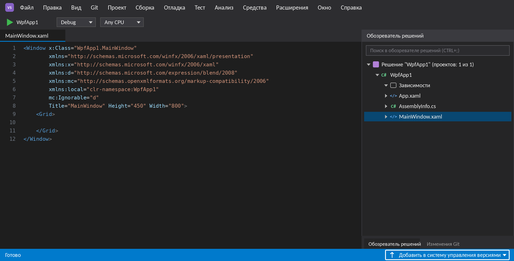
   <em>Рисунок 1 – Проект WpfApp1, открытый в Visual Studio</em>

### 3.2 Создание репозитория и публикация проекта на GitHub

Репозиторий можно создать двумя способами, я рассмотрел оба. Первый способ – через главное меню: Git → «Создать репозиторий Git…» (рисунок 2).

  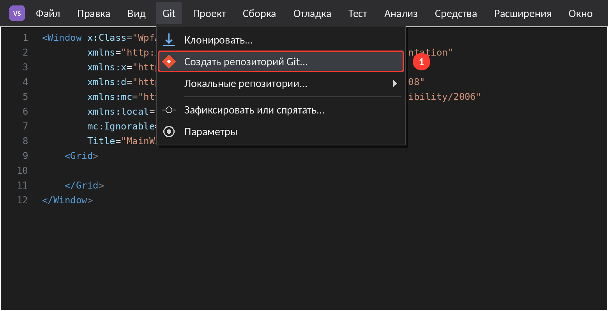
   <em>Рисунок 2 – Меню Git → «Создать репозиторий Git…»</em>

Второй способ – открыть вкладку «Изменения Git» рядом с Обозревателем решений и нажать кнопку «Создать репозиторий Git…» (рисунок 3).

  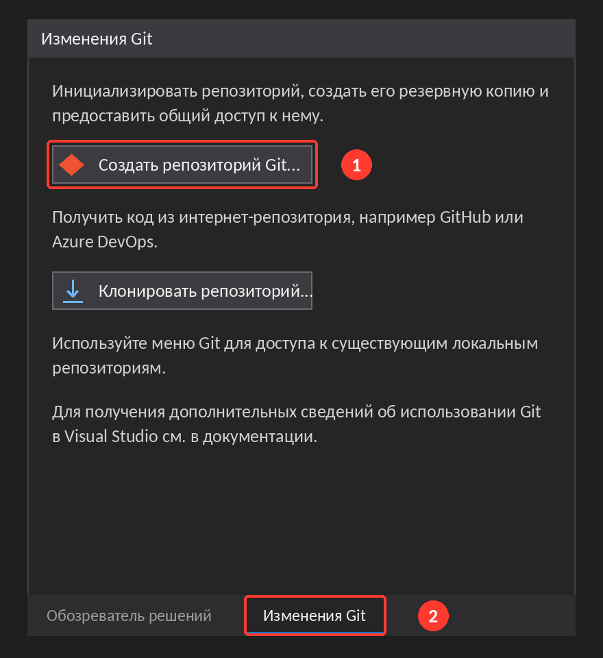
   <em>Рисунок 3 – Вкладка «Изменения Git» – второй способ создания репозитория</em>

После этого открылось окно «Создание репозитория Git» (рисунок 4). Я сделал в нём следующее:

1. слева, в разделе «Отправить на новый удалённый объект», выбрал GitHub (отметка 1);
2. в поле «Учётная запись» вошёл в свой аккаунт GitHub – Visual Studio открыла браузер, где я подтвердил вход (отметка 2);
3. в поле «Имя репозитория» ввёл `WpfApp1_SRS1`, а в «Описание» кратко написал, что это самостоятельная работа 1.1; флажок «Частный репозиторий» оставил включённым (отметка 3);
4. нажал кнопку «Создать и отправить» (отметка 4).

  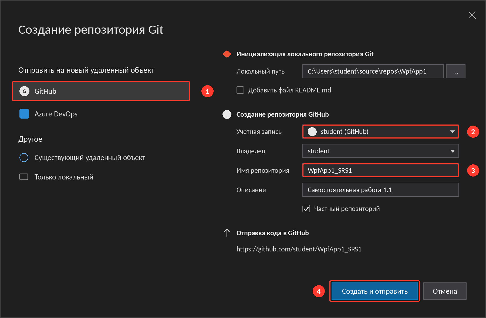
   <em>Рисунок 4 – Окно «Создание репозитория Git» с заполненными полями</em>

Дальше Visual Studio всё сделала сама: инициализировала локальный репозиторий (это аналог команды `git init`), создала репозиторий на GitHub, подключила его как удалённый `origin` и отправила туда файлы проекта первым коммитом `Add project files.` В окне «Изменения Git» появилось сообщение о том, что репозиторий создан, а в списке веток – основная ветка `master` и счётчик «Исходящих 0/входящих 0» (рисунок 5).

  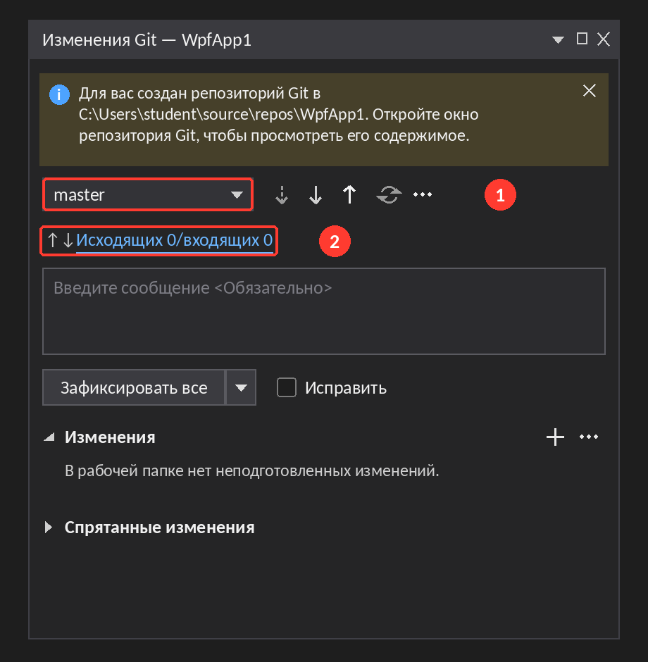
   <em>Рисунок 5 – Окно «Изменения Git» после создания репозитория</em>

Я открыл сайт GitHub и проверил результат: репозиторий `WpfApp1_SRS1` появился в моём аккаунте, в нём лежат папка проекта, файл решения и `.gitignore` (рисунок 6).

  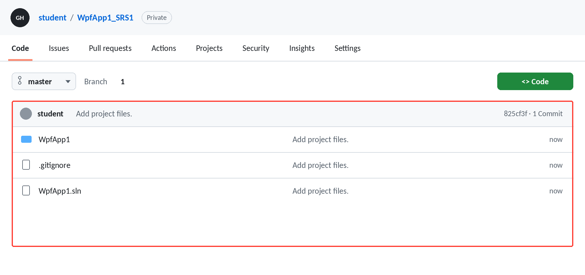
   <em>Рисунок 6 – Репозиторий WpfApp1_SRS1 на GitHub</em>

### 3.3 Изменения в проекте

Чтобы было что фиксировать, я изменил проект. В файле `MainWindow.xaml` поменял заголовок окна на «Мой первый проект на GitHub» и добавил элемент `TextBlock` с текстом «Привет, GitHub!». После сохранения файла в окне «Изменения Git» в разделе «Изменения» появился `MainWindow.xaml` с пометкой `M` (modified, то есть изменён) – рисунок 7. Если навести мышь на файл, справа появляются две кнопки: стрелка (отменить изменения и вернуть файл к последнему коммиту) и плюс (подготовить файл к коммиту, то есть добавить в индекс).

  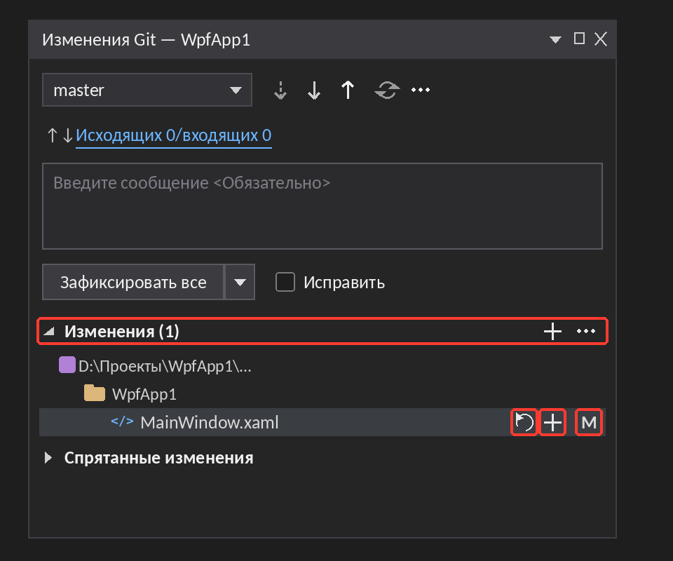
   <em>Рисунок 7 – Изменённый файл MainWindow.xaml в разделе «Изменения»</em>

Чтобы увидеть, что именно я поменял, я дважды щёлкнул по файлу – открылось сравнение с версией из последнего коммита (рисунок 8). Слева старая версия, справа новая: красным отмечено то, что убрали, зелёным – то, что добавили.

  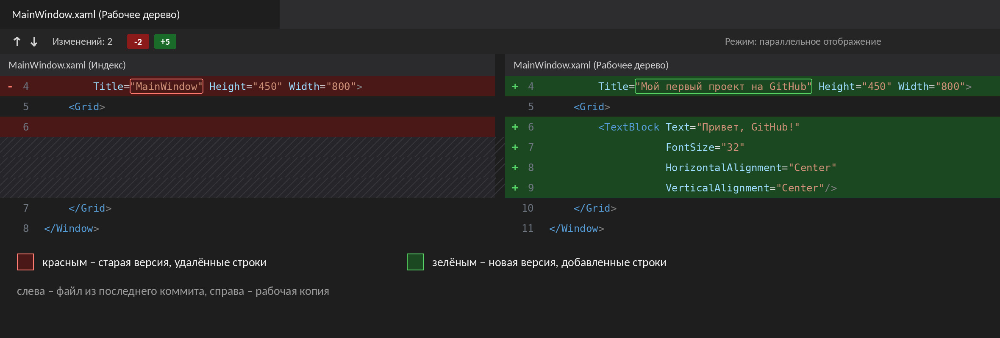
   <em>Рисунок 8 – Сравнение MainWindow.xaml с версией из последнего коммита</em>

Из этого я понял, что Git делит файлы на три состояния: неизменённые, изменённые (но ещё не подготовленные) и подготовленные. В следующий коммит попадают только подготовленные файлы – либо вообще все изменённые, если коммитить «все» без подготовки. Эти два пути я и проверил (рисунок 9).

  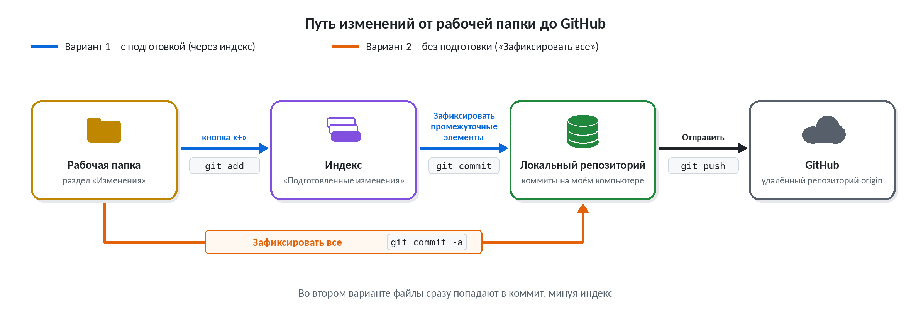
   <em>Рисунок 9 – Два пути изменений от рабочей папки до GitHub</em>

### 3.4 Вариант 1 – фиксация с подготовкой изменений

Сначала сделал коммит через индекс:

1. Нажал «+» рядом с файлом `MainWindow.xaml`. Это то же самое, что `git add MainWindow.xaml`. Файл переехал из раздела «Изменения» в раздел «Подготовленные изменения» (рисунок 10, отметка 1). Если нажать «+» у заголовка раздела «Изменения», в индекс попадут сразу все файлы (`git add .`), а кнопка «–» убирает файл из индекса обратно (`git reset`).
2. В поле сообщения написал `Add greeting text to MainWindow` (отметка 2).
3. Нажал кнопку «Зафиксировать промежуточные элементы» (отметка 3) – это аналог `git commit -m "сообщение"`.
4. После коммита в окне «Изменения Git» появилась надпись «Исходящих 1/входящих 0». Это значит, что коммит уже есть на моём компьютере, но на GitHub его ещё нет (рисунок 11, слева).
5. Нажал стрелку вверх «Отправить» (`git push`) – счётчик стал «Исходящих 0/входящих 0» (рисунок 11, справа).

  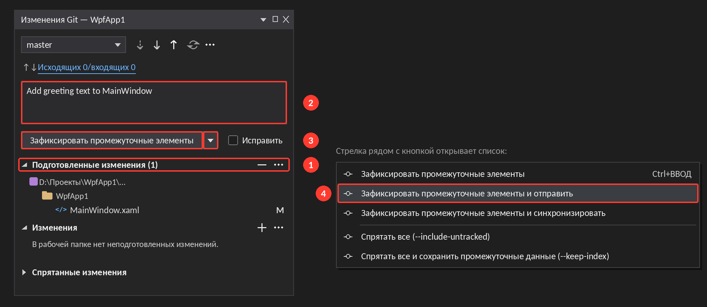
   <em>Рисунок 10 – Вариант 1: подготовленный файл, сообщение коммита и список действий у кнопки</em>

  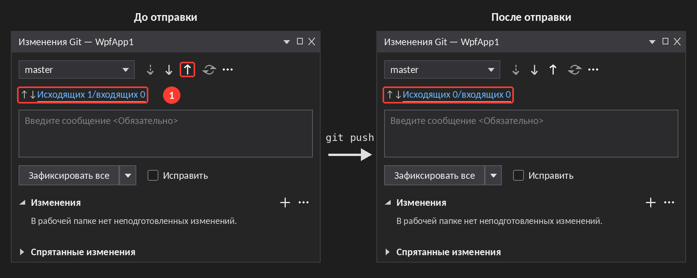
   <em>Рисунок 11 – Счётчик исходящих фиксаций до и после отправки</em>

Есть и более короткий путь: нажать стрелку рядом с кнопкой коммита и выбрать «Зафиксировать промежуточные элементы и отправить» (отметка 4 на рисунке 10) – тогда коммит и отправка выполняются одним действием.

Проверил на GitHub: в истории репозитория появился новый коммит `Add greeting text to MainWindow` (рисунок 12).

  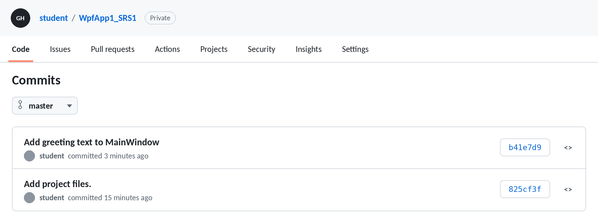
   <em>Рисунок 12 – История коммитов на GitHub после варианта 1</em>

### 3.5 Вариант 2 – фиксация всех изменений без подготовки

Для второго варианта я изменил другой файл – `MainWindow.xaml.cs`: добавил метод `ShowGreeting()`, который показывает окно с приветствием. Файл сохранил, но «+» не нажимал, поэтому он остался в разделе «Изменения» (рисунок 13, отметка 1).

1. Написал сообщение `Add ShowGreeting method` (отметка 2).
2. Нажал кнопку «Зафиксировать все» (отметка 3) – это аналог `git commit -a`: Visual Studio сама берёт все изменённые файлы, и подготавливать их не нужно.
3. Отправил коммит на GitHub. Можно нажать «Отправить» после коммита, а можно сразу выбрать в списке у кнопки «Зафиксировать все и отправить» (отметка 4) – я воспользовался вторым вариантом.

  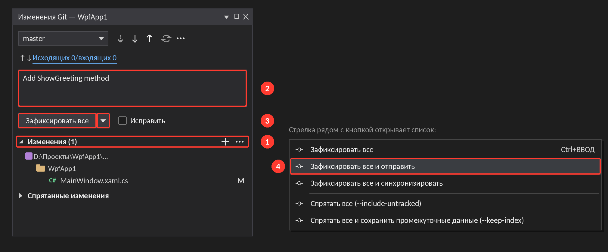
   <em>Рисунок 13 – Вариант 2: фиксация без подготовки и отправка одним действием</em>

На GitHub появился ещё один коммит – `Add ShowGreeting method`. Теперь в истории три коммита: первый от Visual Studio и два моих (рисунок 14).

  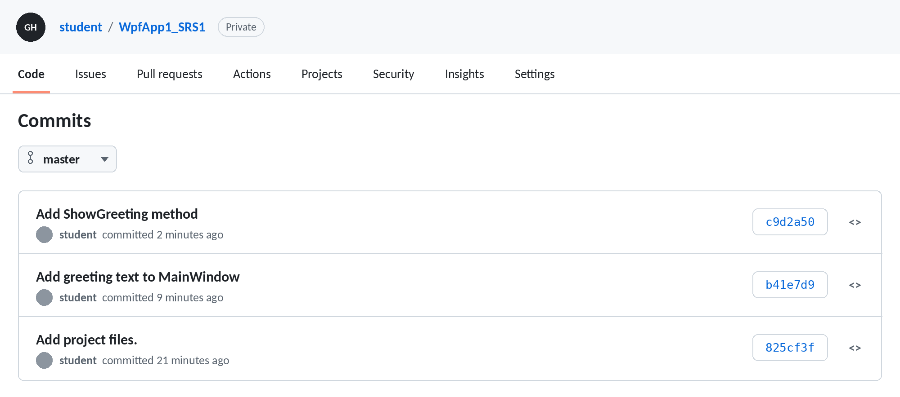
   <em>Рисунок 14 – История коммитов на GitHub после варианта 2</em>

### 3.6 Сравнение двух вариантов

|   | С подготовкой изменений | Без подготовки |
|---|---|---|
| Кнопка коммита | «Зафиксировать промежуточные элементы» | «Зафиксировать все» |
| Подготовка файлов | Нужна, кнопка «+» (`git add`) | Не нужна |
| Аналог в Git | `git add` и `git commit -m` | `git commit -a` |
| Что попадает в коммит | Только подготовленные файлы | Все изменённые файлы |
| Отправка | «Отправить» или «…и отправить» | «Отправить» или «…и отправить» |

По моим наблюдениям, вариант с индексом удобен, когда накопилось много правок и их нужно разбить на несколько аккуратных коммитов. Если изменение одно или все правки относятся к одной задаче, быстрее нажать «Зафиксировать все».

### 3.7 Исходящие и входящие фиксации

Ещё я разобрался со счётчиком «Исходящих/входящих». Исходящие – это мои коммиты, которые ещё не отправлены на GitHub; чтобы отправить их, нужна кнопка «Отправить» (`git push`). Входящие – коммиты, которые есть на GitHub, но нет у меня. Их можно забрать двумя способами: «Извлечь» (`git fetch`) только скачивает новые коммиты, не меняя мою ветку, а «Получить» (`git pull`) скачивает и сразу сливает изменения с текущей веткой.

## 4 Вывод

В ходе работы я создал репозиторий Git средствами Visual Studio, опубликовал в GitHub свой WPF-проект и отправил в него два коммита: один с подготовкой изменений (`git add` + `git commit`), другой без подготовки (`git commit -a`). Я научился смотреть различия между версиями файла, следить за счётчиком исходящих и входящих фиксаций и проверять результат на сайте GitHub. Теперь я могу хранить историю изменений проекта и при необходимости вернуться к любой предыдущей версии.

